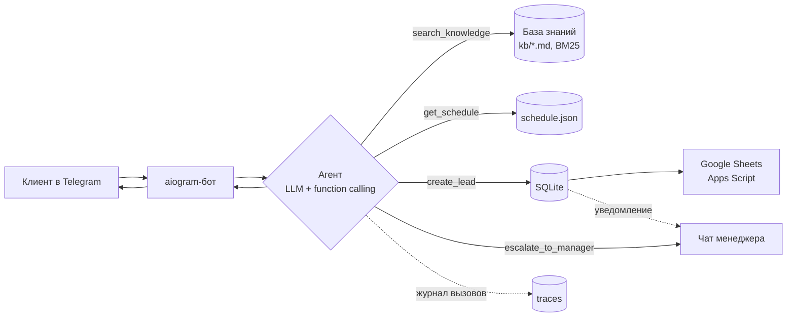

# biz-agent — ИИ-менеджер для малого бизнеса в Telegram

ИИ-агент, который работает первой линией в Telegram: отвечает на вопросы по базе знаний, показывает расписание, записывает клиентов и сам решает, когда позвать живого менеджера.

Демо-бизнес — клуб кикбоксинга. Под другой бизнес (салон, студия, автосервис, школа) переделывается заменой файлов в `kb/` и одной строки в `.env`, код не трогается.

ПОПРОБОВАТЬ: @agentum_demo_bot

## Что умеет

| Клиент пишет | Что делает агент |
|---|---|
| «Сколько стоит абонемент?» | ищет в базе знаний → отвечает только по найденному |
| «Что во вторник вечером для новичков?» | вызывает расписание с фильтром по дню и группе |
| «Запишите на пробную, Иван, 8912…» | собирает данные → проверяет телефон → сохраняет заявку → уведомляет менеджера → (опц.) пишет в Google-таблицу |
| «Верните деньги!!!» / «Позовите человека» | передаёт диалог менеджеру с причиной, кратким пересказом и срочностью |
| «Какая погода?» | мягко возвращает к теме, ничего не выдумывает |

Ключевое: **модель сама выбирает инструмент** (function calling), а не идёт по жёсткому сценарию. Цепочка может быть многошаговой: найти цену → проверить расписание → записать.

## Как устроено



- **Цикл агента** (`agent/core.py`): модель → вызовы инструментов → результаты обратно модели → … → ответ. Лимит шагов защищает от зацикливания; при сбое клиент получает вежливый фолбэк, а не тишину.
- **Инструменты** (`agent/tools.py`): 4 штуки, каждая — JSON-схема + функция. Ошибка инструмента не роняет агента, а возвращается модели как текст, чтобы она могла переспросить.
- **База знаний** (`agent/kb.py`): markdown, нарезка по заголовкам, поиск BM25 с простым русским стеммингом. Без эмбеддингов и внешних сервисов — бесплатно и мгновенно. Интерфейс `search(query, k)` позволяет заменить на pgvector/Qdrant для больших баз.
- **Память** (`agent/storage.py`): SQLite — история диалога на каждого клиента, заявки, передачи менеджеру и журнал всех вызовов инструментов.
- **Модель**: любая OpenAI-совместимая с поддержкой tools через OpenRouter (по умолчанию `openai/gpt-4o-mini`).

## Как выглядит


## Для менеджера

- Новые заявки и эскалации приходят в чат `MANAGER_CHAT_ID`.
- `/leads` — последние 10 заявок.
- `/trace` — последние действия агента: какие инструменты он вызывал и с какими аргументами. Удобно, чтобы понять, почему агент ответил именно так.

## Быстрый старт

```bash
git clone https://github.com/<you>/biz-agent.git && cd biz-agent
python3 -m venv venv && source venv/bin/activate
pip install -r requirements.txt
cp .env.example .env          # вписать токен бота и ключ OpenRouter

python -m agent.cli           # поговорить с агентом в терминале, видно каждый вызов инструмента
python -m agent.bot           # запустить Telegram-бота
pytest -q                     # 14 офлайн-тестов, ключи не нужны
```

`MANAGER_CHAT_ID`: напишите боту `/id` и вставьте число в `.env`.

### На сервер (systemd)

```bash
cp deploy/biz-agent.service /etc/systemd/system/
systemctl daemon-reload && systemctl enable --now biz-agent
journalctl -u biz-agent -f
```

### Google-таблица (необязательно)

Код приёмника — `integrations/sheets_apps_script.js`, инструкция внутри файла. URL веб-приложения → `SHEETS_WEBHOOK_URL`.

## Как адаптировать под другой бизнес

1. Заменить файлы в `kb/` — любые `.md`, каждый заголовок `#` становится отдельным фрагментом для поиска.
2. Заменить `kb/schedule.json` (или удалить инструмент, если расписания нет).
3. Поменять `BUSINESS_NAME` в `.env` и при необходимости правила в `prompts/system.md`.
4. Новый инструмент (проверка свободных слотов, статус заказа, расчёт стоимости): схема в `TOOL_SCHEMAS` + метод с тем же именем в `Tools`.

## Структура

```
agent/
  core.py      цикл агента
  tools.py     инструменты и их схемы
  kb.py        база знаний и поиск
  storage.py   SQLite
  bot.py       Telegram
  cli.py       консольный режим
  app.py       сборка из конфига
kb/            база знаний демо-бизнеса
prompts/       системный промпт
integrations/  Google Sheets
deploy/        systemd-юнит
tests/         офлайн-тесты с подменённой моделью
```

## Стек

Python 3.10+, aiogram 3, OpenAI SDK (OpenRouter), SQLite, BM25, Google Apps Script, systemd.

---

Автор: Иван Шумков · [getagentum.com](https://getagentum.com)
